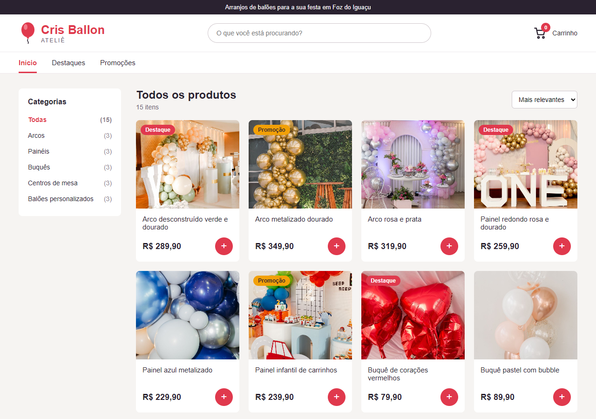
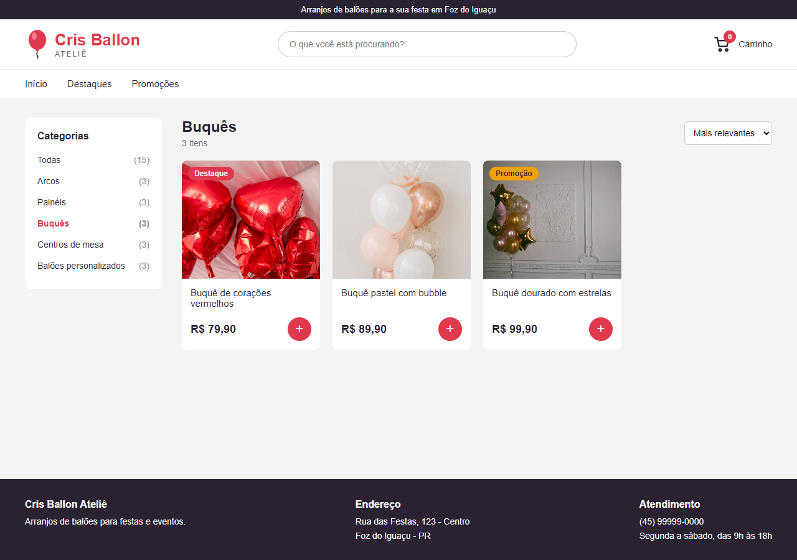
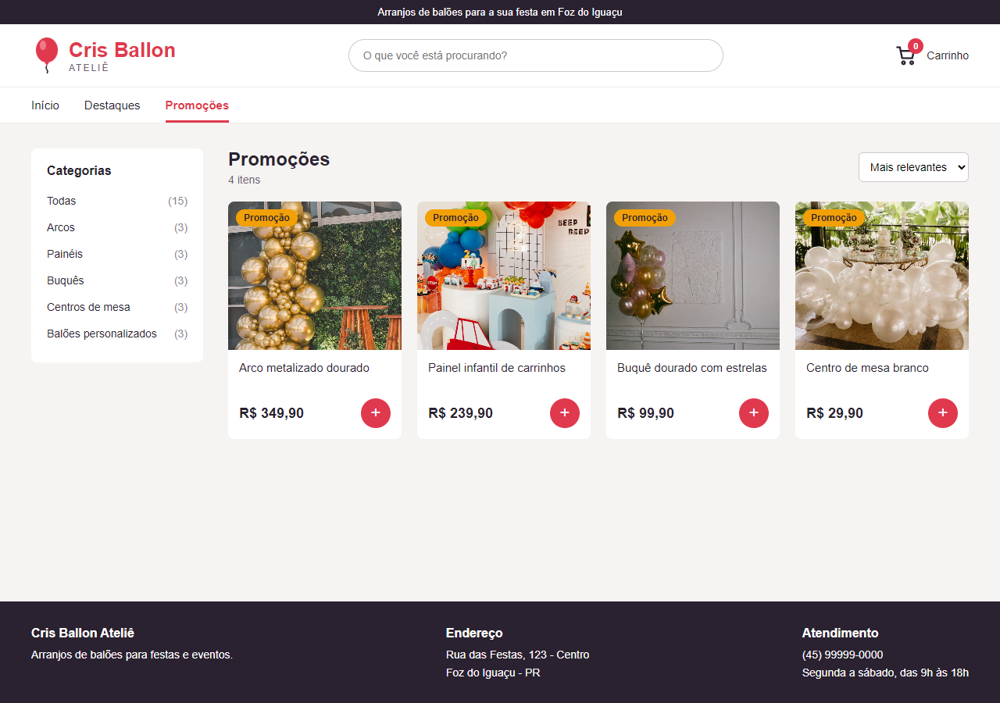
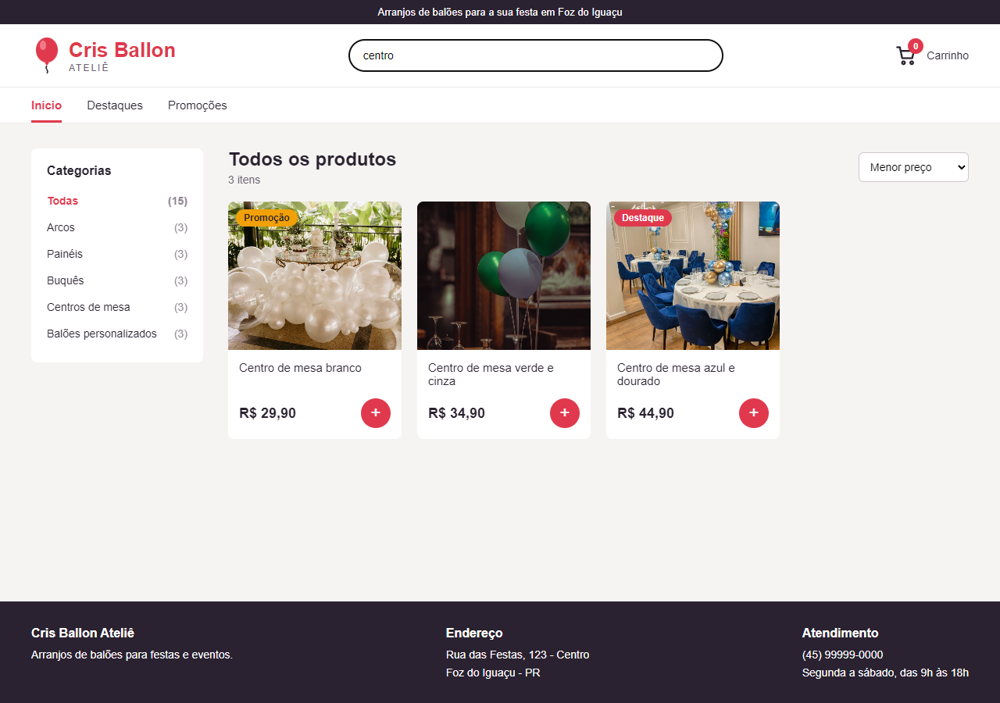
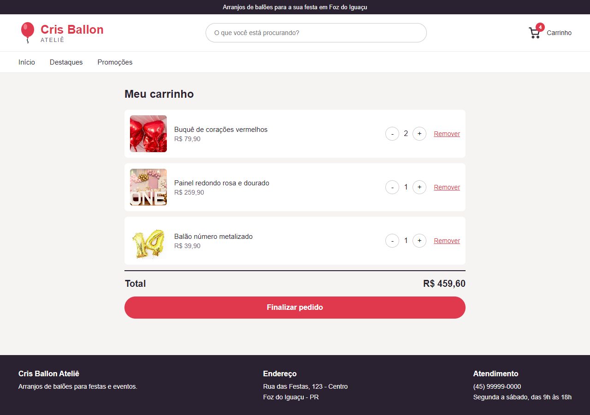
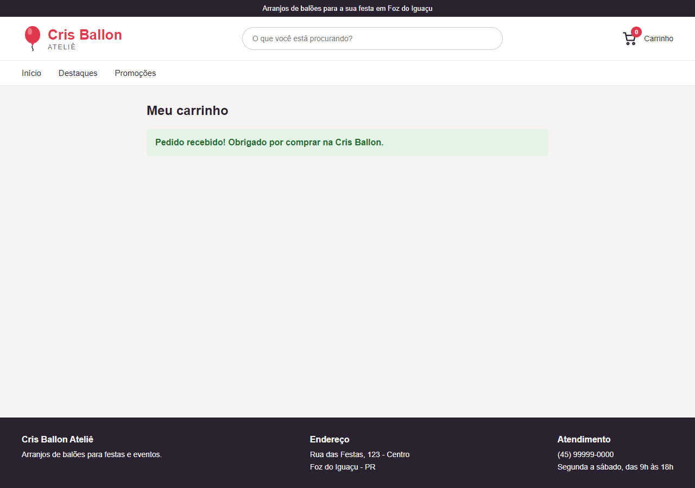
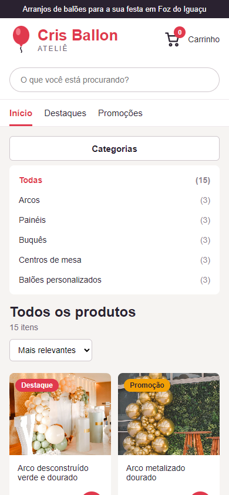

# Loja Cris Ballon Ateliê!

Site de vendas da loja de balões Cris Ballon Ateliê, onde o cliente pode ver os arranjos, filtrar por categoria, pesquisar, ordenar pelo preço e montar o seu carrinho de compras!

# Como usar este site?
 Para usar o site basta baixar o repositório em seu computador, extrair a pasta e abrir o arquivo index.html no navegador.

 Os produtos adicionados no carrinho ficam salvos no localStorage do navegador, então eles continuam lá mesmo depois de fechar ou recarregar a página.

### Como executar:
 - Clonar o repositório: git clone https://github.com/MatheussMansur/cris-ballon-web.git
 - Entrar na pasta cris-ballon-web e abrir o arquivo index.html

# O que o site faz:
 - Lista os produtos da loja com foto, nome, preço e etiqueta de destaque ou promoção
 - Filtro por categoria, por destaques e por promoções
 - Busca de produtos pelo nome
 - Ordenação pelo menor ou pelo maior preço
 - Carrinho com quantidade, remover produto e valor total
 - Finalizar pedido
 - Versão para celular com o botão de categorias

Os produtos, preços e dados da loja são de exemplo, e as fotos são do site Pexels.

# Capturas de tela:

#### 1. Tela inicial:

#### 2. Filtro por categoria:

#### 3. Promoções:

#### 4. Busca e ordenação:

#### 5. Carrinho:

#### 6. Pedido finalizado:

#### 7. Versão para celular:

#### 7.1. Categorias no celular:

# Colaboradores:
 Matheus Mansur: https://github.com/MatheussMansur
